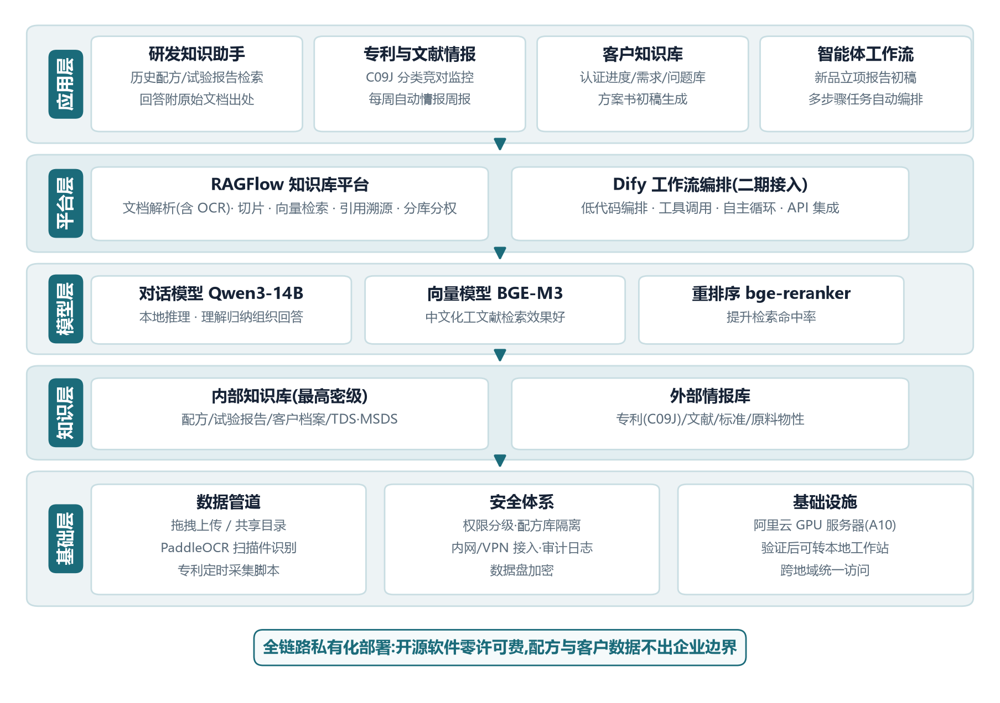

# 企业私有化 AI 知识库(RAG)—— 从售前方案到私有化部署与效果调优

> 为某电子胶黏剂企业(客户信息已脱敏)独立交付的 AI 应用落地项目:业务调研 → 方案设计 → 私有化部署 → RAG 效果调优 → 方法论沉淀,完整闭环。
>
> **当前状态**:实施方案获客户认可,POC 环境已跑通并完成检索效果验收(回答 100% 附原文溯源)。

## 演示视频

真实环境录屏:向知识库提出三个由浅入深的业务问题(单文档参数检索 / 跨文档失效历史追溯 / 经验推理),回答均附引用出处。


*(高清原版视频见 [Releases](../../releases) 附件)*

## 项目背景

客户是一家经营十余年的电子胶黏剂精细化工企业(40+ 头部客户、双基地运营、筹备 IPO),核心痛点:

| 业务场景 | 痛点 | AI 方案 |
|---|---|---|
| 研发知识 | 历史配方/试验报告散落个人电脑,经验依赖资深工程师记忆 | 研发知识助手:自然语言检索,回答附原始文档出处 |
| 专利情报 | 立项查新临时进行,竞对专利布局无人跟踪 | C09J 分类专利监控 + 每周情报周报 |
| 客户知识 | 认证进度/技术需求分散在邮件与个人表格 | 客户知识库,支撑销售与应用工程协作 |

## 我的角色与交付物(独立完成)

1. **需求调研与方案设计** —— 多角色访谈、场景优先级排序,输出客户实施方案([公开仓库提供脱敏节选版](docs/实施方案-脱敏版.pdf)),含技术路线、量化验收标准设计与报价框架
2. **私有化部署** —— 资源受限(6GB 内存 Linux)环境部署 Dify 1.17.1 全栈(14 个 Docker 容器);网络受限(Docker Hub/GitHub 不可达)下设计"镜像站预拉 + retag"方案,独立排查修复容器挂载异常故障
3. **RAG 效果调优** —— 建立"查引用 → 验召回 → 改配置"调试法,经分段策略重构、混合检索 + Rerank、防幻觉提示词三轮迭代,验收问答全部达标([调优实录](docs/02-RAG调优实录.md))
4. **语料工程** —— 设计 8 份互相关联的化工技术文档(专利/试验报告/TDS/失效分析/客户纪要),覆盖跨文档溯源场景([语料说明](docs/03-演示语料说明.md))

## 系统架构



**技术栈**:Dify(私有化部署)/ RAG / Qwen3-14B & DeepSeek(对话模型,API)/ BGE-M3(Embedding)/ bge-reranker-v2-m3(Rerank)/ Docker Compose / Linux / Python / Prompt 工程

全链路开源自部署,软件零许可费,数据不出企业边界。

## RAG 调优亮点(节选,完整记录见 [docs/02-RAG调优实录.md](docs/02-RAG调优实录.md))

| Badcase | 根因 | 修复 |
|---|---|---|
| 回答给出导热系数却称"未提及固化条件" | 默认按空行切块,数字与条件被切进不同块 | 分段标识符改为文档内不存在字符,整文档成块 |
| 模型拒绝回答"知识库中暂无信息"(实际召回成功) | 防幻觉提示词矫枉过正 + Score 阈值误杀召回 | 提示词增加"部分相关必须作答"规则,关闭阈值 |
| 跨文档失效历史被漏答 | 未启用精排,关键文档未进 Top K | 检索切至 Rerank 模型(bge-reranker-v2-m3) |

## 仓库结构

```
├── README.md                 # 本文件
├── assets/                   # 架构图 / 实施路线图 / 演示视频
├── corpus/                   # 演示语料(8 份脱敏化工技术文档)
└── docs/
    ├── 01-部署SOP.md          # 受限网络环境 Dify 私有化部署手册
    ├── 02-RAG调优实录.md      # 三个 badcase 的完整诊断与修复过程
    ├── 03-演示语料说明.md     # 语料设计思路与命名规范
    └── 实施方案-脱敏版.pdf     # 客户实施方案节选版(第一至四章:背景/需求/技术路线;客户与商务信息已脱敏)
```

## 适用场景

本项目的部署 SOP、排障路径、调优框架与需求确认清单均可直接复用于:制造业知识管理、文档密集型企业的私有化 AI 问答、售前 POC 快速搭建。
